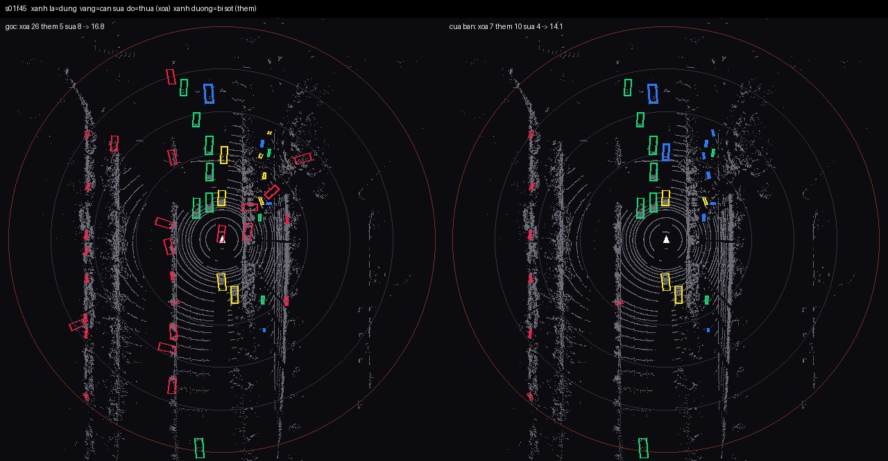

# Báo cáo Day 14 — Bùi Lê Đình Văn — 2A202603124

- Mã học viên dùng với `--student`: `124`
- `seed_tag` trong `frames_A.txt`: `393590736f`

## 1. Dự đoán trước sweep (bước 5b)

Ghi **trước** khi chạy `scripts/pp_sweep.py`, rồi commit và push ngay (lịch sử commit là bằng chứng thời điểm viết). Không sửa phần này sau khi có kết quả.

- Tham số tôi nghĩ giảm công sửa nhiều nhất: `score_thr=0.3` kết hợp `min_points=5`.
- Vì sao (nhìn ảnh BEV tập A: box thừa nhiều hay box sót nhiều?): Quan sát ảnh BEV tập A và số đo baseline (97 box dự đoán so với 47 box thực tế, phải xóa 59 box thừa trong khi chỉ thêm 9 box sót), box thừa nhiễu xuất hiện nhiều hơn hẳn box bị sót nên việc tăng ngưỡng tin cậy `score_thr` lên `0.3` và lọc box ít điểm bằng `min_points=5` sẽ loại bỏ mạnh các dự đoán sai và giảm tổng công sửa.

## 2. Tập A: sửa tay và tune

| Cấu hình | Xóa | Thêm | Sửa | Chi phí |
|---|---:|---:|---:|---:|
| Gốc | 59 | 9 | 17 | 35.2 |
| `best_config.json` | 11 | 19 | 9 | 26.8 |

- Tham số đã đổi trong `best_config.json`: `score_thr: 0.1 -> 0.5` (giữ nguyên `min_points: 0`).
- Kết quả leave-one-out (dán các dòng `scripts/pp_sweep.py` in ra):
  ```text
  Leave-one-out (chọn trên các frame còn lại, chấm trên frame bỏ ra):
    s01f45: cấu hình chọn {'score_thr': '0.5', 'min_points': '0'} → 14.1 (tốt nhất có thể 14.1)
    s03f56: cấu hình chọn {'score_thr': '0.5', 'min_points': '0'} → 9.4 (tốt nhất có thể 9.4)
    s04f32: cấu hình chọn {'score_thr': '0.5', 'min_points': '0'} → 3.3 (tốt nhất có thể 3.3)

## 3. Trước/sau (bước 8)



- `scripts/pp_compare.py` báo giảm **24%** công sửa trên tập A (từ `35.2` xuống `26.8`).
- Dự đoán ở mục 1 đúng hay sai? Giải thích bằng số box xóa/thêm/sửa: Dự đoán ở mục 1 **đúng hướng** về nguyên nhân chính (tăng `score_thr` để giảm mạnh lượng box thừa nhiễu), nhưng chưa chọn ngưỡng đủ cao và kỳ vọng quá mức vào `min_points`. Thực tế trên tập A, việc tăng mạnh `score_thr` từ `0.1` lên `0.5` giúp số box phải xóa giảm mạnh từ `59` xuống `11` (giảm 48 box thừa) và số box phải sửa giảm từ `17` xuống `9`, dù số box phải thêm tăng từ `9` lên `19` (+10 box sót) nhưng tổng chi phí sửa vẫn giảm từ `35.2` xuống `26.8` (giảm 24%); trong khi tại mức `score_thr=0.5`, thay đổi `min_points` (0, 5, 10) đều cho cùng chi phí `26.8` nên không tạo thêm khác biệt.

## 4. Tập B

Số đo từ `scripts/pp_prelabel.py --frames d14_124/frames_B.txt --config d14_124/best_config.json --gt d14_124/ref_B.json`:

| Xóa | Thêm | Sửa | Chi phí |
|---:|---:|---:|---:|
| 30 | 23 | 7 | 35.5 |

- Loại box tốn công sửa nhất ở tập B: Các box bị sót phải thêm mới hoàn toàn (23 box, chiếm tỷ trọng cao nhất trong tổng chi phí `23 × 1.0 = 23.0 / 35.5`), chủ yếu là các xe ô tô ở khoảng cách xa, bị che khuất một phần hoặc cụm điểm LiDAR thưa nên không vượt qua ngưỡng `score_thr=0.5`, cùng các đối tượng nhỏ/hẹp như xe máy (`Cyclist`) hoặc người đi bộ (`Pedestrian`) đòi hỏi phải dựng lại từ đầu, căn tâm và chỉnh góc quay 3D trên nhiều góc nhìn.

## 5. Giới hạn

- **Tập tune rất nhỏ (chỉ 3 frame Tập A):** Việc chọn siêu tham số chỉ dựa trên 3 frame nên dễ bị phụ thuộc vào mật độ xe và bối cảnh của riêng 3 frame đó; khi sang 12 frame Tập B đa dạng hơn, ngưỡng cao `score_thr=0.5` giúp giảm mạnh box thừa nhưng đồng thời làm tăng lượng box bị bỏ sót phải vẽ mới (23 box).
- **Lệch miền dữ liệu và bộ nhãn (Domain & Label Gap):** Model PointPillars được huấn luyện sẵn trên tập KITTI chỉ có 3 lớp (`Car`, `Pedestrian`, `Cyclist`), không có lớp `Truck` hay `Bus` riêng biệt nên các xe tải/xe buýt lớn trên đường Việt Nam dễ bị nhận nhầm sang `Car`, lệch kích thước chuẩn hoặc bị bỏ sót.
- **Hàm chi phí mới chỉ là công thức ước lượng:** Trọng số `0.3 × xóa + 1.0 × thêm + 0.5 × sửa` chưa phản ánh chính xác thời gian thao tác thực tế trên giao diện 3D (ví dụ: vẽ mới một hộp ở xa bị khuất hoặc chỉnh góc quay yaw 180° tốn công hơn nhiều so với điều chỉnh kích thước nhẹ).